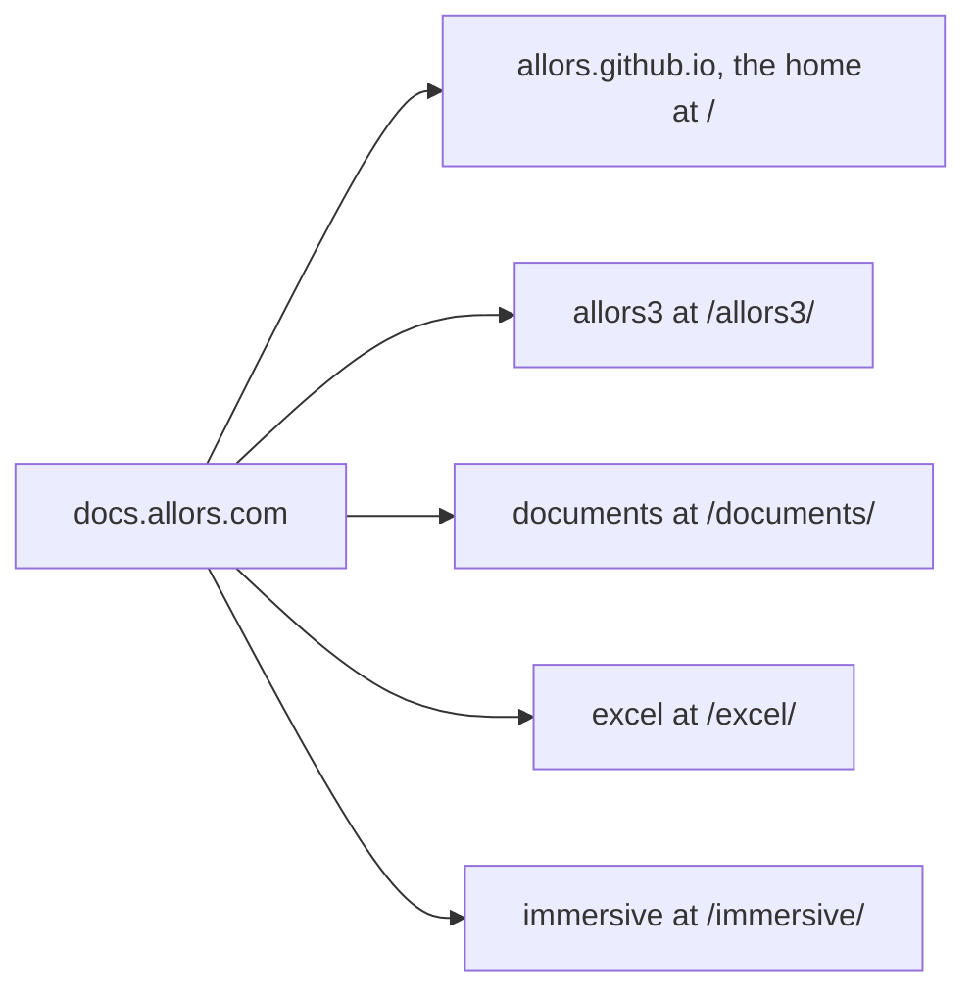

> **Status: Planned.** The website, its Markdown exports and the checks that the documentation
> workflow runs are built and pass. Publication to GitHub Pages has not been run: the repository
> is private, Pages is not enabled and the custom domain is not configured.

This record describes the documentation home: the website at the root of the shared
documentation address, beneath which the Allors3 platform and the supporting open-source tools
publish their documentation from their own repositories. The [index](../index.md) is the page
readers see; the [website instructions](../../../../README.md) cover local development, checks
and publication.

## Decision

| Area | Decision |
| --- | --- |
| Readers | The index orients the users and maintainers of every area and lists the agent indexes. This record serves the maintainers of the home. |
| Site | Astro with Starlight at the root of the repository, with the content in `src/content/docs/`. Markdown; MDX and components are available when a page needs them. |
| Hosting | GitHub Pages, built with GitHub Actions, as the organisation site of the `allors` organisation. |
| Address | `https://docs.allors.com`, a custom domain on the organisation site. The repository keeps the name `allors.github.io`; the next section says why. |
| Areas | Allors3 at `/allors3/`, Documents at `/documents/`, Excel at `/excel/` and Immersive at `/immersive/`, each published beneath the same address from its own repository by its own documentation workflow. The home links to the areas; it does not build them. `site.mjs` lists them for the sidebar and the link checker. |
| Scope | The home covers Allors3 and the supporting open-source tools. The repository is public once published and holds nothing but the home. |
| Version context | The home documents its own `main` and has no product version; the label on its pages says `main`. Each area carries its own version label. |
| Publication | The documentation workflow validates every pull request and push. Publication is a manual run on `main` with `publish` selected, as in the areas. |
| Checks | The tooling tests, the Astro check, the production build with exports, the link check and the browser tests with accessibility checks, for the base path `/`. |

## Why the repository keeps its name

An arrow points from the domain to a repository that publishes beneath it; the label of a
repository says the path at which its site is served.

GitHub serves the site of a repository named `<organisation>.github.io` at the organisation's
root address, and a custom domain set on that site is used for every project site of the
organisation: a project site is served at the custom domain followed by its repository name. A
repository named `docs.allors.com` would be a project site. Its pages would be served at
`allors.github.io/docs.allors.com/`, and a custom domain on it would serve that one site and
leave the areas at `allors.github.io/<repository>/`. Keeping the name gives the areas their paths
beneath the domain without configuration of their own. GitHub's documentation on
[the types of sites](https://docs.github.com/en/pages/getting-started-with-github-pages/about-github-pages)
and on [custom domains](https://docs.github.com/en/pages/configuring-a-custom-domain-for-your-github-pages-site/about-custom-domains-and-github-pages)
states both rules; consulted on 2026-10-19.

The `allors` organisation is on GitHub's Free plan, which publishes Pages from public
repositories only, so the repository becomes public at publication. The home was placed on the
subdomain `docs.allors.com` rather than beneath the company website on 2026-10-19, so that the
documentation publishes independently of that website.

## What was reused

The files were copied from the Allors Excel adoption at commit `042f2a4`, the latest on its
`main` on 2026-10-19, because that copy reads the site title and description from `site.mjs` and
carries the fixes made since the Allors3 original. The changes for the home:

| File | Change for the home |
| --- | --- |
| `site.mjs` | Title, description, the version label `main`, repository, the default origin `https://docs.allors.com`, the default base path `/`, and the list of areas. |
| `astro.config.mjs` | Sidebar: the index, the platform and the open-source tools as absolute links to the areas, and the maintainer pages. Edit links point to the repository root, because the website is not in a `docs/` folder. |
| `integrations/source-links.mjs` | The repository root is one level above `integrations/`, not two. |
| `scripts/check-links.mjs` | The default origin and base path. A link into an area is left to that area's build and counted as unchecked, instead of being reported as a missing file. |
| `integrations/exports.mjs`, `integrations/scrollable-content.mjs`, `integrations/focusable-code-blocks.mjs`, `src/components/PageTitle.astro`, `src/content.config.ts`, `src/styles/documentation.css`, `public/favicon.ico`, `tsconfig.json`, `playwright.config.ts`, `.gitignore` | Unchanged. |
| `package.json`, `package-lock.json` | The package name; the pinned dependency versions are identical. |
| `tests/exports.test.mjs`, `tests/links.test.mjs`, `tests/source-links.test.mjs`, `tests/fixtures/anchors.md` | Base paths, repository paths and the version string, and a test for the links into the areas. |
| `tests/browser/documentation.spec.ts` | The page names and the diagram, and a test that the sidebar links to every area at the origin. |
| `.github/workflows/documentation.yml` | One base path, the repository root as the working directory, and no path filter, because the repository holds nothing but the website. |

This is the fifth copy of the shared set that the Immersive, Allors Documents and Allors Excel
records describe. Extracting that set into one implementation is a decision for the Allors
projects together; until then, port fixes between the copies and keep them identical where the
table says so.

## Validation

On 2026-10-19 the following ran locally at the repository root for the base path `/`:
`npm test`, `npm run check`, `npm run build`, `npm run check:links` and `npm run test:browser`,
as the [website instructions](../../../../README.md#check-a-change) describe. The exported
`index.md` and `llms.txt` were read: the index carries the table of the areas with absolute links
to their Markdown indexes and agent indexes, and no name of an unpublished project appears in the
build output.

Automated checks do not establish that an explanation is accurate or clear. The index describes
each area in that area's own published words; change the description when the area changes its
own.

## Publication

Remaining, in this order:

1. Make the repository public.
2. Verify `docs.allors.com` for the organisation, with the TXT record GitHub gives, so that no
   other account can claim the domain.
3. Enable Pages with GitHub Actions as the source and run the **Documentation** workflow on
   `main` with **publish** selected. The home appears at `https://allors.github.io/`.
4. Set `docs.allors.com` as the custom domain of the repository, add the DNS record
   `docs.allors.com CNAME allors.github.io`, and enforce HTTPS once the certificate exists.
5. Switch the areas' deployment origin to `https://docs.allors.com` and publish them from their
   repositories.

Mark this record Current when the home is published, and revisit it when the areas are.

## Open choices

- Search covers one area at a time. Pagefind can combine independent indexes; whether the home
  offers search across the areas is open and needs testing against the published areas.
- The retention of older published versions of an area is a decision of that area. The home
  links to the documentation of `main`.
- The company website is being replaced. When the new website exists, it and the home link to
  each other.
- The extraction of the shared tooling, as above.
